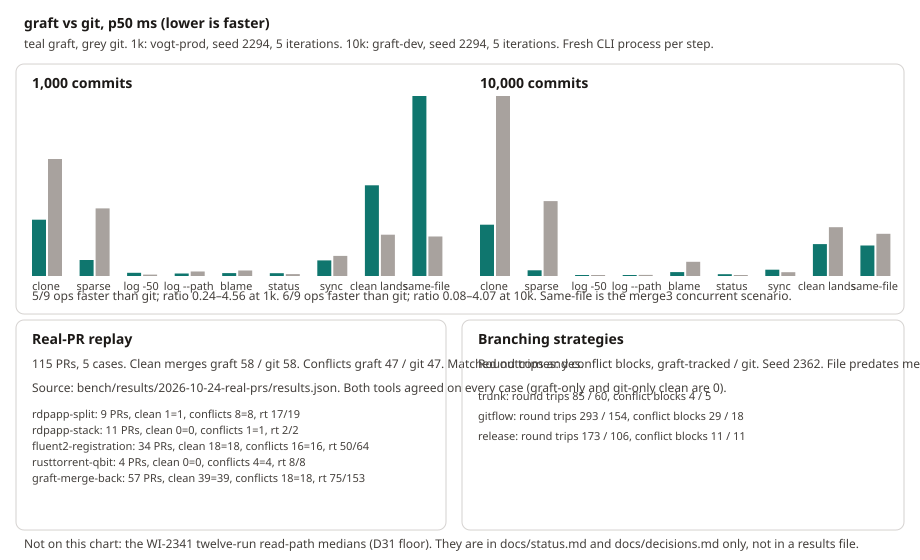

# graft

[](https://github.com/TheDancingDeveloper-org/graft/actions/workflows/ci.yml)
[](LICENSE)
[](https://github.com/TheDancingDeveloper-org/graft/releases)

**Server-centric source control for AI agent fleets.**

Many clients share one history, and the server does the commit, history, diff,
rebase and land. Concurrent work lands on a shared line with no branch or pull
request per change, and a conflict comes back in your files rather than in a
review queue. The commands look like git's, because the ideas are close.

- **Built for many short sessions on one codebase.** Leased workspaces, stacked
  drafts, server-side rebase and compare-and-swap lands.
- **Conflicts are returned, not queued.** A land that overlaps another exits
  with code 3 and writes merge markers into the working copy.
- **Agent-native.** A CLI, an MCP server (`graft mcp`) and an LSP server share
  one API. Session and work-item identity travel with each change.
- **An exit path.** Import a git repository losslessly, follow it, deliver
  batches to GitHub as pull requests, and export the full history back to git.

graft does not run builds, tests or checkers, and it does not speak the git
wire protocol.

## Status

graft is **pre-1.0**; the
[latest release](https://github.com/TheDancingDeveloper-org/graft/releases/latest)
is a 0.x version. It works end to end as source control: local and server
modes, clone (full and sparse), commit, sync, land with line merge, history
reads, git import and export, MCP and LSP. Formats and the protocol are
versioned, and 0.x releases may still change behaviour; see
[Stability](docs/guide/stability.md). What is delivered and what is planned is
in [Project status](docs/status.md) and the [roadmap](docs/roadmap.md).

## Install

Download a release archive (Linux x86_64 or aarch64, static musl) and check it
against the published `SHA256SUMS`:

```sh
curl -fsSLO https://github.com/TheDancingDeveloper-org/graft/releases/latest/download/graft-x86_64-unknown-linux-musl.tar.gz
curl -fsSLO https://github.com/TheDancingDeveloper-org/graft/releases/latest/download/SHA256SUMS
sha256sum --ignore-missing -c SHA256SUMS
tar -xzf graft-x86_64-unknown-linux-musl.tar.gz
./graft version
```

Or run the container image (tags match releases, for example `v0.1.2`):

```sh
docker run --rm ghcr.io/thedancingdeveloper-org/graft:v0.1.2 version
```

Or build from source with a recent stable Rust toolchain:

```sh
cargo install --git https://github.com/TheDancingDeveloper-org/graft graft-cli
```

All three give you the single `graft` binary. `graft serve`, `graft node` and
`graft mirror` are subcommands of it: the server, the per-host cache and git
import and export. macOS binaries are not published yet and Windows is not
supported; on those platforms build from source or use the container.
There is no crates.io package yet.

Shell completions:

```sh
source <(graft completions bash)   # bash
source <(graft completions zsh)    # zsh
graft completions fish | source    # fish
```

## Quick start: local

`graft init` creates a repository the CLI opens in-process: no server, no
daemon, no token. A second working copy is a `graft clone` of the first.

<!-- docs-smoke: local -->
```sh
graft init demo && cd demo
printf 'one\n' > file.txt
graft commit -m "start"
graft log
graft clone . ../demo-2          # a second working copy of the same repository
printf 'one\ntwo\n' > file.txt
graft commit -m "add a line"
graft land                       # moves the line by compare-and-swap
```
<!-- /docs-smoke: local -->

From the second copy, edit a different region of `file.txt`, commit and land.
Line merge (merge3) keeps both edits. A second land of an overlapping edit
exits 3, lists the paths and writes nothing. `graft land --sync` (or
`graft sync`) moves to the tip and writes the conflict markers into the file.

## Quick start: server

`graft serve --dev` starts a loopback server, creates a repository named
`dev`, stores an admin token in your user config (never on stdout or in a
command line) and prints the clone command. It keeps running.

```sh
graft serve --dev
# prints: graft clone graft://127.0.0.1:PORT/dev
```

In another terminal, clone with the printed command, then commit and land. The
working copy uses the named server `dev`, so no token is ever an argument.

<!-- docs-smoke: server -->
```sh
graft clone graft://127.0.0.1:PORT/dev
cd dev
printf 'hello\n' > readme.txt
graft commit -m "hello"
graft sync
graft land
```
<!-- /docs-smoke: server -->

To use a server you already run, `graft login NAME` stores it; the token is
read from standard input or `--token-file`. For a production-style deployment
see the [server guide](docs/guide/server.md).

## Using graft with agents

The agent loop is clone, edit, commit, sync, land. The
[agent guide](docs/agents.md) covers the loop, exit codes and the rules an
agent should follow. MCP runs over stdio and needs no flags inside a working
copy:

```sh
claude mcp add graft -- graft mcp
```

Configuration snippets for other clients (`graft mcp --print-config codex`,
`graft mcp --print-config cursor`), the tool list and the server's `/mcp`
endpoint are in the [MCP reference](docs/guide/mcp.md).

## Migrating from and to git

| Step | Command | What it does |
| --- | --- | --- |
| Import | `graft mirror import` | Lossless import of a git repository, including raw tag objects |
| Follow | `graft mirror follow` | Keep a git remote and graft in step |
| Batch export | `graft repo batch cut` | Deliver lands to GitHub as one pull request, one commit per land |
| Full export | `graft mirror export` | Write the whole history back out to git |

Git import and export live behind `graft mirror`; nothing else in graft speaks
git. See the [git migration guide](docs/guide/git-migration.md).

## How it compares

| | graft | git | jj | Sapling |
| --- | --- | --- | --- | --- |
| Unit of history | changeset on a shared line | commit on a branch | change | commit, with a server |
| Concurrent work | many working copies land on one line | branch and pull request per change | local changes, no server | server-backed stacks |
| Conflicts | returned in the files (merge3) | merge or rebase, client-side | client-side | client-side |
| Where the work runs | the server | the client | the client | client plus server |
| Agent surface | CLI, MCP, LSP | CLI | CLI | CLI |
| Maturity | pre-1.0 | mature | mature | mature |

Command names follow git where the meaning is the same; graft does not try to
be git-compatible. See the [FAQ](docs/guide/faq.md) and
[Concepts](docs/guide/concepts.md).

## Performance



Clone, sparse clone, log, blame, status, sync and concurrent lands at 1,000 and
10,000 commits, measured against git on the same host. Methods and caveats are
in [Benchmarks](docs/guide/benchmarks.md).

## Documentation

**User guide**

- [Concepts](docs/guide/concepts.md): glossary and a git-to-graft table
- [CLI reference](docs/guide/cli.md): every command, generated from `graft --help`
- [MCP reference](docs/guide/mcp.md): every tool, with arguments and results
- [Server guide](docs/guide/server.md): configuration, tokens, repositories, lines, metrics, upgrades
- [Git migration](docs/guide/git-migration.md): import, follow, batch pull requests, export
- [CI attestation](docs/guide/ci-attest.md): exchange a GitHub OIDC identity for an attest-only token
- [Agent guide](docs/agents.md): how an agent session uses graft
- [FAQ](docs/guide/faq.md), [Safety](docs/guide/safety.md), [Stability](docs/guide/stability.md), [Benchmarks](docs/guide/benchmarks.md)

**Project**

- [Project status](docs/status.md) and [roadmap](docs/roadmap.md)
- [Architecture](docs/architecture.md) and [design](docs/design.md)
- [Changelog](CHANGELOG.md)
- [Engineering record](docs/internal/README.md): plans, decisions, trials and runbooks

## Contributing

Issues and pull requests are welcome. Read [CONTRIBUTING.md](CONTRIBUTING.md)
first; for a design change, open an issue to discuss it before writing code.
Report vulnerabilities privately, as described in [SECURITY.md](SECURITY.md).

## Licence

[AGPL-3.0-only](LICENSE).

Running an unmodified graft server inside your organisation adds no
obligations. They arise when you offer a modified server over a network to
others, who must then be able to get its source. See the
[FSF GNU licences FAQ](https://www.gnu.org/licenses/gpl-faq.html#UnreleasedModsAGPL).
