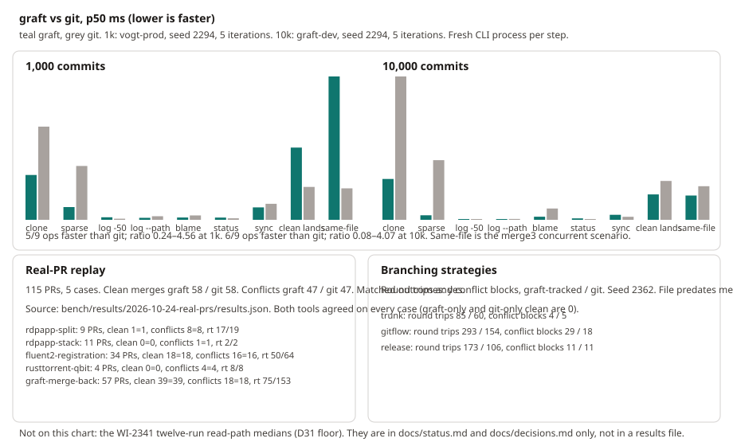

# graft

[](https://github.com/TheDancingDeveloper-org/graft/actions/workflows/ci.yml)
[](LICENSE)
[](https://github.com/TheDancingDeveloper-org/graft/releases)

graft is a server-centric source control system: many clients share one
history, and the server does the commit, history, diff, rebase and land.
It is for agent fleets — many short sessions on one codebase — that need
git-like commands without a branch or a pull request per change.

**Status: pre-v0.1.0, phase 1 (a git alternative).** Local mode
(`graft init`), a loopback server (`graft serve --dev`), clone, commit,
sync, line-merge land, named-server login and git export work through the
CLI, MCP and LSP. graft does not run builds, tests or checkers. What is
delivered is in [docs/status.md](docs/status.md).

## Install

There is no crates.io package and no published release yet. Build the CLI
from this repository:

```sh
cargo install --git https://github.com/TheDancingDeveloper-org/graft graft-cli
```

That installs the `graft` binary. `graft serve`, `graft node` and
`graft mirror` are subcommands of that binary (the server, the host cache,
and git import and export).

Release binaries and the container image are produced by the release
workflow when a `v*` tag is pushed. They are not published yet. The
locations that tag will use:

```sh
curl -fsSL -o graft.tar.gz https://github.com/TheDancingDeveloper-org/graft/releases/download/vX.Y.Z/graft-x86_64-unknown-linux-musl.tar.gz
tar -xzf graft.tar.gz
./graft version

docker run --rm ghcr.io/thedancingdeveloper-org/graft:vX.Y.Z version
```

Archives are Linux x86_64, Linux aarch64 and macOS Apple Silicon. There is
no Intel macOS archive. crates.io is not available yet; install with the
git command above.

## Quick start: local

`graft init` creates a repository the CLI opens in-process: no server, no
daemon, no token. A second working copy is `graft clone` of the first.

<!-- docs-smoke: local -->
```sh
graft init demo && cd demo
printf 'one\n' > file.txt
graft commit -m "start"
graft log
graft clone . ../demo-2          # a second working copy of the same repository
printf 'one\ntwo\n' > file.txt
graft commit -m "add a line"
graft land                       # moves the line by compare-and-swap
```
<!-- /docs-smoke: local -->

From the second copy, edit a different region of `file.txt`, commit and
land. Line merge (merge3) keeps both edits. A second land of an overlapping
edit exits 3, lists the paths and writes nothing. `graft land --sync` (or
`graft sync`) moves to the tip and writes the conflict markers into the file.

## Quick start: server

`graft serve --dev` starts a loopback server, creates a repository named
`dev`, stores an admin token in the user config (never on stdout or the
command line) and prints the clone command. It keeps running.

```sh
graft serve --dev
# prints: graft clone graft://127.0.0.1:PORT/dev
```

In another terminal, clone with the printed command, then commit and land.
The working copy uses the named server `dev`, so no token is an argument.

<!-- docs-smoke: server -->
```sh
graft clone graft://127.0.0.1:PORT/dev
cd dev
printf 'hello\n' > readme.txt
graft commit -m "hello"
graft sync
graft land
```
<!-- /docs-smoke: server -->

`graft login NAME` stores a server you already run: the token is read from
stdin or `--token-file`, never taken as an argument. A longer stack is
[docs/dev-stack.md](docs/dev-stack.md).

## Using it with agents

The agent loop is clone, edit, commit, sync, land. A conflict comes back in
the files (exit 3), not as a pull request. The short guide, including the
exit codes and what never to do, is [docs/agents.md](docs/agents.md).

MCP is `graft mcp` on stdio. Inside a working copy it needs no flags:

```sh
claude mcp add graft -- graft mcp
```

Codex and Cursor snippets (`graft mcp --print-config codex` and
`graft mcp --print-config cursor`), the tool list, and the server `/mcp`
form are in [docs/agents.md](docs/agents.md).

## Migrating from git

| Step | Command | What it does |
| --- | --- | --- |
| Import | `graft mirror import` | Lossless import of a git repository, including raw tag objects |
| Follow | `graft mirror follow` | Keep a git remote and graft in step |
| Batch export | `graft mirror pr-batch` | Deliver lands to GitHub as one pull request, one commit per land |
| Full export | `graft mirror export` | Write the history back out to git. This is the exit path |

Git import and export stay behind `graft mirror`. Nothing else in graft speaks git.

## How it compares

| | graft | git | jj | Sapling | OpenScion |
| --- | --- | --- | --- | --- | --- |
| Unit of history | changeset on a shared line | commit on a branch | change | commit, with a server | changeset (Scion model) |
| Concurrent work | many working copies land on one line | branch and pull request per change | local changes, no server | server-backed stacks | designed for agent fleets |
| Conflict | returned in the files (merge3) | merge or rebase, client-side | client-side | client-side | returned to the client |
| Where the work runs | the server | the client | the client | client plus server | a server |
| Agent surface | CLI, MCP, LSP | CLI | CLI | CLI | not published |
| Status | pre-v0.1.0, phase 1 | mature | mature | mature | a design, not a product |

graft does not run builds, tests or checkers. It does not try to be
git-compatible. Command names follow git where the meaning is the same.

## Benchmarks



One chart from the committed result files: clone, sparse clone, log,
`log --path`, blame, status, sync and concurrent lands at 1,000 and
10,000 commits, plus a real-PR replay and the branching-strategy runs.
How it was measured, and what is not on the chart, is in
[docs/guide/benchmarks.md](docs/guide/benchmarks.md).

## Documents

| Document | What it covers |
| --- | --- |
| [docs/roadmap.md](docs/roadmap.md) | where graft is going: the pull request as a bridge, verification, gates as policy, the authority switch |
| [docs/design.md](docs/design.md) | goals, data model, storage, API, landing, git interop |
| [docs/status.md](docs/status.md) | what is delivered, measured numbers, and what is still open |
| [docs/plan.md](docs/plan.md) | phases, backlog, and the build waves as history |
| [docs/decisions.md](docs/decisions.md) | operator decisions, including phase 1 (D22) and the phase-1 bar (D31) |
| [docs/architecture.md](docs/architecture.md) | crate map, the idea in six lines, runtime and deploy diagrams |
| [docs/agents.md](docs/agents.md) | the agent loop, exit codes, MCP |
| [CONTRIBUTING.md](CONTRIBUTING.md) | how changes land |
| [AGENTS.md](AGENTS.md) | rules for agent sessions working in this repository |

## Contributing

graft is early. The design is [docs/design.md](docs/design.md); work lands
on short-lived branches through the merge queue. See
[CONTRIBUTING.md](CONTRIBUTING.md).

## Licence

[AGPL-3.0-only](LICENSE).
