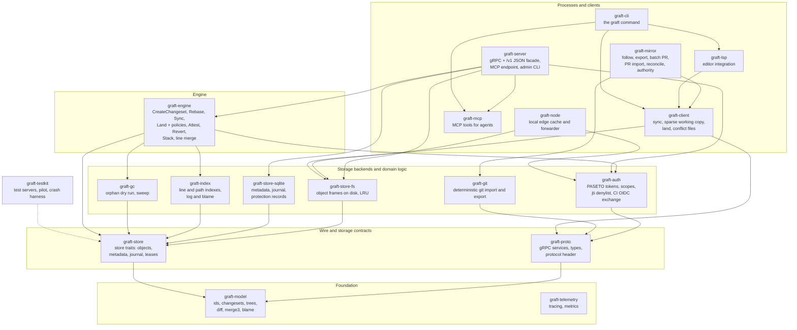
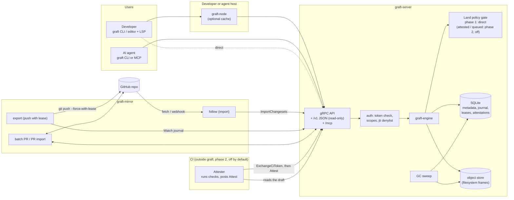
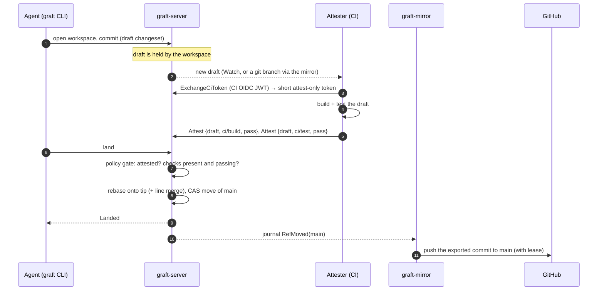
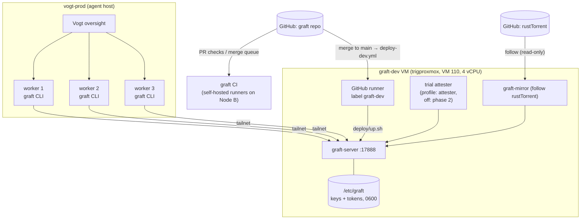
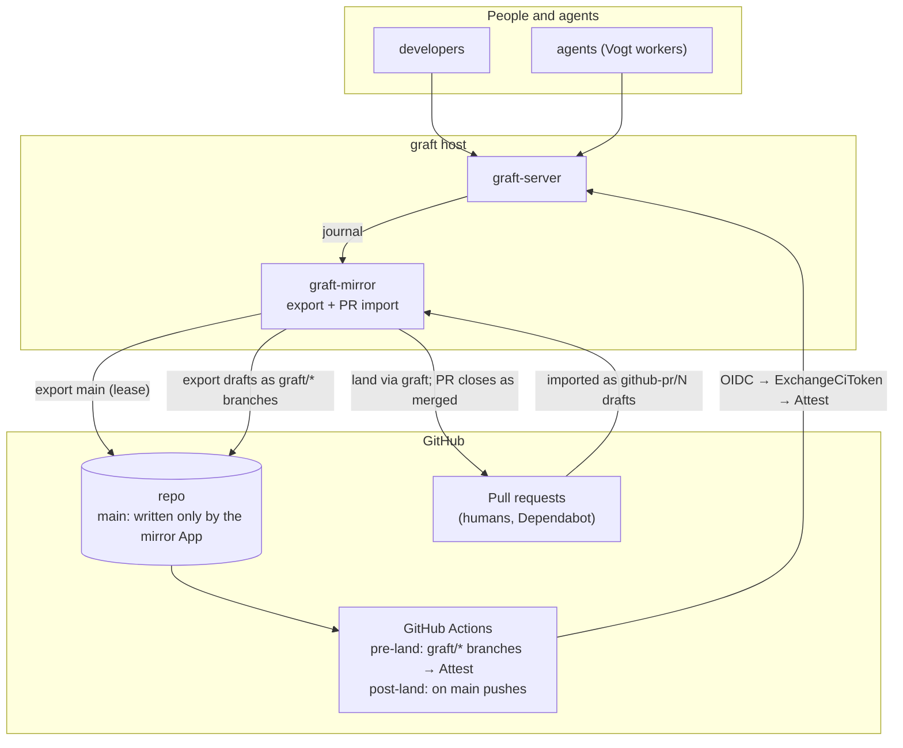
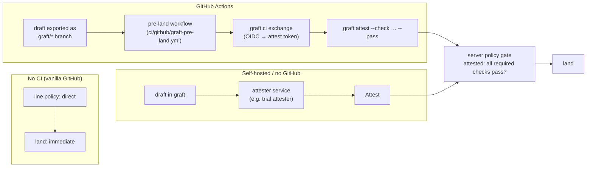
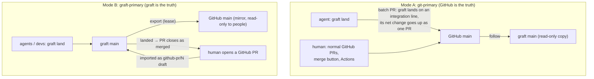

# graft architecture (diagrams)

This is the visual companion to [design.md](design.md). It shows four things:

1. The code layout: crates and how they depend on each other.
2. The components at runtime, and how they talk to each other.
3. The deployment topologies, including CI.
4. What an **attester** is, and how graft fits with GitHub, with and without CI.

The diagrams are Mermaid, which GitHub renders. Where this page and the design
disagree, the design wins.

> **Phase note ([D22](decisions.md#d22-phase-1-is-a-git-alternative)).** In
> phase 1, lines are `direct` and nothing runs CI in the land path. The
> attester and attestation flows in section 4 are phase 2, built but switched
> off. Topology 3b (graft-primary `main` with GitHub as the mirror) is not
> planned; GitHub delivery is the batch PR of 3c (D21).

---

## 1. Code layout

graft is one Cargo workspace with 19 crates under `crates/`. They form layers.
A crate depends only on crates in the same layer or a lower one.



Which crate does what:

| Crate | Owns |
| --- | --- |
| `graft-model` | Pure types and algorithms: changeset and tree ids, diff (histogram), `merge3`, blame |
| `graft-proto` | The gRPC API (`RepoService`, `WorkspaceService`, `ObjectService`, `AdminService`, `CiService`) and the `graft-protocol` version header |
| `graft-store` | Store traits. Everything above them is backend-agnostic |
| `graft-store-fs`, `graft-store-sqlite` | Object bytes on disk; metadata, journal and leases in SQLite |
| `graft-auth` | Tokens, scopes (`read`, `write`, `land:<line>`, `attest`, `admin`), and the CI OIDC → graft token exchange |
| `graft-engine` | All repository semantics. The server is a thin shell around it |
| `graft-gc` | Finding orphans and collecting them (deletion is off per repo by default) |
| `graft-git` | Lossless, deterministic git ↔ graft conversion |
| `graft-mirror` | Keeps a git remote (GitHub) and graft in step (§3) |
| `graft-server` | The network process |
| `graft-node` | Optional per-host cache that forwards to the server |
| `graft-client`, `graft-cli`, `graft-lsp`, `graft-mcp` | How people, editors and agents use graft |

---

## 2. Components at runtime



The server is the only writer to its stores. Everything else is a client:
people, agents, the mirror and the attester. Each authenticates with its own
token and scopes. In phase 1 there is no attester: the policy gate passes
every `direct` land, and nothing outside the server takes part in a land.

### One land, step by step (phase 1: `direct`)

```mermaid
sequenceDiagram
  autonumber
  participant A as Agent (graft CLI)
  participant S as graft-server
  participant M as graft-mirror

  A->>S: open workspace, commit (draft changeset)
  Note over S: draft is held by the workspace
  A->>S: land
  S->>S: rebase onto tip (+ line merge, merge3)
  alt clean
    S->>S: CAS move of the line
    S-->>A: Landed
    S-->>M: journal RefMoved(line)
  else conflict
    S-->>A: Conflict {paths, tip}, nothing moves; the client syncs and resolves, as with git
  end
  Note over M: pr-batch sends the line to GitHub as a batch PR, one commit per land (D26); land-pr rebase-merges it (D28)
```

### One land with an attested policy (phase 2, off by default)



---

## 3. Deployment topologies

### 3a. Today's dev topology (graft-dev VM, contained trial)



- GitHub isn't written. `rusttorrent` follows GitHub read-only.
  `rusttorrent-trial` is graft-primary with no export.
- Under D22 the trial line `trial-1` is `direct`, and the attester profile
  is off. When it is on (phase 2), it stands in for CI, because the trial
  runs no GitHub Actions.

### 3b. Target topology: graft-primary with GitHub as the mirror



### 3c. Batch mode: an integration line, one batch PR with one commit per land (D21, D26, D28)

The near-term way of working. `main` stays git-primary and graft follows it.
Agents land on a graft integration line forked from graft's `main`.
`graft-mirror pr-batch <line> --base main` sends the line's lands to GitHub
as one batch PR carrying one commit per land (D26). Oversight reviews the PR
as a whole and `land-pr` rebase-merges it once GitHub's required checks pass
(D28). GitHub CI runs once per batch.

```mermaid
sequenceDiagram
  participant A as agents
  participant S as graft-server
  participant M as graft-mirror pr-batch
  participant G as GitHub
  participant O as oversight (land-pr)
  A->>S: land on integration (many times)
  M->>G: follow main (ls-remote, fetch, import)
  M->>S: sync: Rebase the line's net change onto main; CAS the line
  M->>M: one commit per land on GitHub's main (deterministic)
  M->>G: push graft/batch-n (lease: must not exist)
  M->>G: open the PR (lands, sessions, work items, Graft-Batch)
  O->>G: review; rebase-merge once required checks pass (graft never merges)
  M->>G: follow imports the merged commits
  M->>S: batch recorded as merged; the next batch counts from its tip
```

- **Sync.** When `main` moved, the line's net change since the base it last
  absorbed is rebased onto `main`'s tip (line merge, D16). A merge
  changeset (first parent the line tip, second `main`'s tip) moves the line
  by compare-and-swap, so the move is a fast-forward. A conflict is
  reported with its paths, and nothing moves.
- **One commit per land.** `graft/batch-<n>` is a chain of commits on
  GitHub's `main`, one per land in land order (sync changesets skipped),
  each with the land's author and message and `Graft-Changeset`,
  `Graft-Session`, `Graft-Work-Item` and `Graft-Checks` trailers. The last
  commit's tree equals the integration tip's tree. A batch carries at most
  500 per-land commits; a longer line is cut into consecutive batches.
- **Squash is the fallback.** When replaying the lands onto the base does
  not reproduce the integration tip, the batch is exported as one squashed
  commit, and the PR body and the commit say why.
- **Every land is listed.** The PR body lists as many lands as fit under
  GitHub's body limit, and names the commit messages for the rest.
  Listings stop at the newest 5,000 lands.
- **Review and merge.** Oversight reviews the batch PR as a whole. For a
  head named `graft/batch-<n>`, `land-pr` waits for the required checks and
  rebase-merges past the squashing merge queue (`--admin`), keeping the
  per-land commits. graft never merges, queues or approves the PR.
- **One batch open per line.** While its PR is open, a run only reports it.
  A PR closed unmerged marks the batch rejected, and its lands stay on the
  line for the next batch.
- **Retries are safe.** The commit chain is built from recorded fields and
  each land's own time, and stored before it is pushed, so a re-run pushes
  the same shas and adopts the PR already on the branch.

---

## 4. The attester, and GitHub with or without CI

### What an attester is

An **attestation** is a signed statement that a named check passed or failed
for one exact draft changeset. For example: "`ci/test` passed for changeset
`c7f…`, log at URL".

An **attester** is anything that runs checks and posts attestations. It holds
an attest-only, short-lived token pinned to that one changeset. It can't
write code, land, or attest any other changeset.

The server never runs builds. It only **checks** attestations at land time,
and only when the line's policy asks for them. So graft works with any CI, or
with none.

| Land policy on a line | Needs an attester? | GitHub equivalent |
| --- | --- | --- |
| `direct` | No. Lands at once; optional post-land CI and auto-revert | A repo with no required status checks: anyone with write can merge a PR |
| `attested` | Yes. Lands only when the required checks are attested for that draft | Branch protection with **required status checks** |
| `queued` | Yes. The candidate is tested after rebase, before the ref moves | GitHub **merge queue** |

Run vanilla GitHub without CI, and the graft equivalent is `direct`. Nothing
needs an attester. The attester exists only to make `attested` and `queued`
work, the same way required checks need a CI system to report them.

### Where attestations come from, by setup



### Concept map: GitHub to graft

| GitHub | graft | Notes |
| --- | --- | --- |
| Branch + pull request | Workspace + draft stack | No branch per change; a workspace holds the drafts |
| "Merge" button | `graft land` | Rebase onto tip, line merge, CAS move, no merge commits |
| Required status checks | `attested` policy + attestations | Posted by CI through `Attest` |
| Merge queue | `queued` policy | Tests the rebased candidate before the move |
| Status check from Actions | Attestation from an attester | Pinned to one changeset, short attest-only token |
| Branch protection "only X can push" | Line authority + ruleset | In graft-primary, only the mirror App writes GitHub `main` |
| Reviews / CODEOWNERS | Path rules (`require_human_review`) | Per path, per line |

### Who is the source of truth, and what GitHub users can still do

graft runs a line in one of two modes. The mode decides whether GitHub users
change anything.



- **Mode A, git-primary (phases 1–2).** Nothing changes for GitHub users. They
  raise and merge PRs as usual, with or without Actions. Agents read through
  graft, which is fast and sparse. When an agent lands, graft opens a normal
  GitHub PR, so GitHub's checks and merge rules still decide. graft needs no
  attester here.
- **Mode B, graft-primary (phase 3).** graft decides what reaches `main`.
  GitHub users can still open PRs. The mirror imports each one as a draft,
  and it lands through graft's policy:
  - under `direct`, at once;
  - under `attested`, once checks are attested, by Actions or another
    attester.

  The PR then closes as merged. What they can't do is merge on GitHub
  directly. A ruleset keeps `main` writable only by the mirror, because two
  writers would fork history. If someone bypasses that, the mirror stops
  exporting and raises a divergence alert; it never force-pushes.

Moving between modes uses the `graft-mirror authority` steps: freeze, catch
up, verify, flip, unfreeze. Each step can be run in reverse to roll back.
